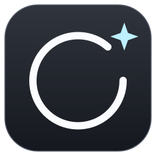

<p align="center"></p>
<h1 align="center">New Start</h1>
<p align="center">A fresh start for the Windows desktop.</p>

**Beta build: 0.1.0-beta.1.** This is pre-release software under active development, with known limitations. It is not a stable or production-ready release.

New Start is an experimental native Windows 11 dock and custom Start menu, built with C#/.NET 8 WPF and a small Windows Composition helper. It keeps Explorer available as a fallback. There is no browser shell, administrator requirement, injection, or modification of Windows taskbar pin storage.

**Source-available for non-commercial use, modification and sharing under [PolyForm Noncommercial 1.0.0](LICENSE).** Commercial use is not granted. A commercial restriction means this is not OSI-approved open-source software.

## Features

- Transparent dock with a white hollow-circle Start button, running indicators and separate pinned/running application sections.
- Top, left or bottom placement. Bottom centre is the default for a new installation.
- Left/centre/right alignment on horizontal edges; top/centre/bottom alignment on the left edge.
- Start opens below a top dock, above a bottom dock, or beside a left dock. Top-centre and bottom-centre Start are centred horizontally on the screen; left-centre Start is vertically centred on the dock. Other layouts follow the Start button and stay within the work area.
- Public Shell AppBar reservation keeps maximised windows clear of the dock with a consistent 8-DIP gap on every edge, without reserving space for menus.
- 16–64 px icon sizing, configurable 125% hover magnification and spring launch bounce, respecting reduced-animation preferences.
- Drag to pin, reorder or remove apps. Imported Windows taskbar pins are read-only and can be hidden locally.
- Application menus with launch, pin/unpin, close and supported automatic Recent destinations.
- Custom Start with Windows-synchronised pins, 6 × 6 sections, whole-page scrolling and conditional page pips; alphabetical All Apps and app search. No recent apps/files section in Start.
- Light/Dark/System appearance, adjustable menu transparency and blur, optional clock, system controls, Task View and Show Desktop, plus the Windows Recycle Bin.
- Account display name/avatar and standard folder/settings shortcuts, resolved locally at runtime.

## Build and run

Requirements: Windows 11 x64, .NET 8 SDK, Visual Studio 2022 or newer Build Tools with **Desktop development with C++**, and a Windows 11 SDK. Running the framework-dependent build requires the .NET 8 Windows Desktop Runtime and Microsoft Visual C++ x64 runtime.

```powershell
./build.ps1
./artifacts/NewStart.exe
```

Keep `NewStart.Backdrop.dll` and the other generated runtime files beside the executable. The preview is unsigned; no installer or automatic startup is configured. CI builds the project on Windows but does not substitute for desktop acceptance tests.

Right-click blank dock space → **New Start settings**. Select the dock edge and alignment there. Escape dismisses menus; use **Exit dock** in settings to exit. Explorer is left intact throughout.

## Project outline

| Area | Main files |
| --- | --- |
| Dock, settings and interaction | `DockWindow.cs`, `DockPins.cs` |
| Placement and screen reservation | `DockGeometry.cs`, `DockReservation.cs` |
| Start and app discovery | `StartMenuWindow.cs`, `StartCatalog.cs` |
| Native integration | `Native.cs`, `TaskbarPins.cs`, `PinIdentity.cs`, `JumpListReader.cs` |
| Appearance and blur | `Appearance.cs`, `ThemedMenus.cs`, `CustomBackdrop.cs`, `native/Backdrop.cpp` |
| Local account/folder/Recycle Bin adapters | `AccountIdentity.cs`, `StartShortcuts.cs`, `RecycleBinIcon.cs` |
| Defaults and persistence | `Preferences.cs` |
| Original branding | `assets/logo.svg`, `assets/Generate-Icon.ps1` |
| Checks | `AuditValidation.cs`, `PinDragValidation.cs`, `LocationValidation.cs` |

See [architecture](docs/ARCHITECTURE.md), [roadmap](docs/ROADMAP.md), [API limitations](docs/API-LIMITATIONS.md), [testing](docs/TESTING.md), [privacy](docs/PRIVACY.md), and [contributing](CONTRIBUTING.md).

## Current limitations

This is a preview, not a complete Explorer replacement. Primary-monitor placement only; no tray icon hosting, native Jump List custom tasks/pinned documents, badges, task progress or thumbnail previews. The physical Windows key still opens Windows Start. Large pin counts can exceed the available dock length. Blur has a measurable graphics/CPU cost and needs more driver/remote-session testing. Dragging across apps and accessibility require broader acceptance coverage.

Windows does not expose a complete public Start/taskbar pin or taskbar-menu API. Compatibility adapters are read-only and can require updates when Windows changes. See [the detailed boundaries](docs/API-LIMITATIONS.md).

## Licence

You may use, change, fork and share the project for the purposes permitted by [PolyForm Noncommercial 1.0.0](LICENSE). Retain the licence and [required notice](NOTICE). The licence text controls, including its non-commercial-purpose definitions; no commercial licence is granted by this repository. The original logo and icon are included under the same terms. Windows and Microsoft product names belong to their respective owners; this is an independent project.

